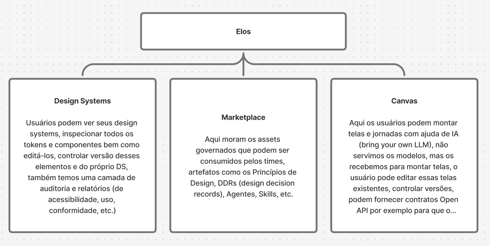

# Elos vision and strategic direction

Status: official. Set 2026-10-24 from the founder's platform diagram. Changes to the areas or their boundaries go through a new ADR that supersedes [ADR 0013](adr/0013-platform-areas.md).

## One sentence

Elos stores design systems in a form that people and AI agents can both use deterministically, and grows from there into the place where teams govern their design decisions and compose product screens with them.

## The platform has four areas

```
                         ┌──────────────┐
                         │     Elos     │
                         └──────┬───────┘
          ┌─────────────────────┼─────────────────────┐
          ▼                     ▼                     ▼
  ┌───────────────┐    ┌───────────────┐    ┌───────────────┐
  │ Design Systems│    │  Marketplace  │    │    Canvas     │
  └───────────────┘    └───────────────┘    └───────────────┘
          └─────────────────────┼─────────────────────┘
                                ▼
                       ┌─────────────────┐
                       │      Serve      │  REST · MCP · exports · skills
                       └─────────────────┘
```

The three areas in the diagram are what users see. Serve is the fourth, invisible area: how everything reaches humans and agents. It is named here so that it is designed once, not re-invented per area. The founder's original drawing is [architecture.png](architecture.png); it is the source for the Elos home (three cards, Serve as a status line) and the boundary between areas ([ADR 0017](adr/0017-canvas-is-its-own-area.md)).



### Design Systems

Users see their design systems, inspect every token and component, edit them, and version both the elements and the system as a whole. An audit and reports layer covers accessibility, usage and compliance.

What exists: the portal with tokens and components areas, live in-context token editing, a component canvas with binding and style editing, a contract form, page examples, versions with publish and rollback.

What completes it: the audit and reports layer, generated from the catalog rather than scanned. Accessibility is contrast per token pair in every theme plus the hit area, keyboard and ARIA declarations in each contract. Usage is which tokens and components the pages and blocks bind to. Compliance is the drift between a draft, its published versions and what consuming code uses. A themes page, a blocks area, import from a directory, authentication and a visual pass on the portal itself belong here too.

### Marketplace

Governed assets that teams consume: design principles, design decision records, agents, skills, and later templates and blocks.

Assets are the same kind of thing as contracts: versioned files in the system directory with a schema, built into the catalog, served through REST and MCP. They are owned by a design system and can be inherited from an organization-level base set, so a principle like "one primary action per view" applies to every system in the organization while a skill like "compose a settings form" belongs to one system.

Governance is part of the moat: an asset in the marketplace is reviewed, versioned and attributable, and an agent consuming it gets the current approved version, never a copy.

### Canvas

Users compose screens and journeys with the help of AI, bring their own model, edit existing screens, version them, and bind them to real data through OpenAPI contracts.

Elos does not serve models. It receives a model and gives it two finite vocabularies: the catalog of components and tokens, and the OpenAPI operations of the product. The model emits composition trees that reference both, and Elos validates them before anything renders. Any model that can follow the catalog produces consistent screens, which is the deterministic promise extended from components to whole screens.

A screen is a composition tree stored as a file in the system directory, so it is versioned, diffed and rolled back with the same mechanism as a component. A journey is an ordered set of screens with the transitions between them.

### Serve

REST and the catalog artifacts for programs. MCP for agents, local over stdio and remote over Streamable HTTP. Exports for tools: the Design System artifact for design mode, DTCG tokens for Figma, Markdown guidelines and generated skills for coding agents. Packages for client codebases, pinned by version.

Every area publishes through Serve and nothing else. One catalog, one access model, one audit trail of who and what consumed which version.

## The spine the four areas share

A design system is a directory of files with schemas: manifest, tokens, themes, contracts, pages, and later principles, DDRs, skills, agents, blocks and screens. The catalog is built from that directory and validated. Drafts and versions are snapshots of the directory. Every area reads and writes this one spine; none has storage or a format of its own. That is what keeps versioning, determinism and Serve uniform as the platform grows.

## Principles that do not change

- Contracts are the source of truth. Nothing is inferred from code.
- Agents never emit markup. They emit trees that are validated against finite vocabularies.
- Everything is versioned the same way: draft, immutable snapshots, computed diffs, rollback by republishing.
- Elos is its own first customer. The portal is built from Resonant and edited in the portal.
- Self-hostable, for clients whose governance requires it.

## Order of work

Design Systems is in progress. Marketplace comes next because principles and skills are what make Canvas output good, and they are small to build on the spine. Canvas comes after the composition adapters and OAuth, since it is where outside models and outside data first meet the catalog. The [roadmap](roadmap.md) carries the phases.
